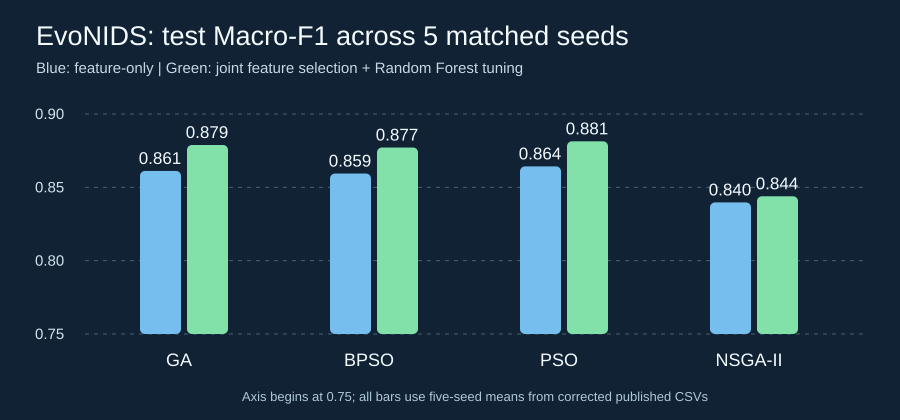
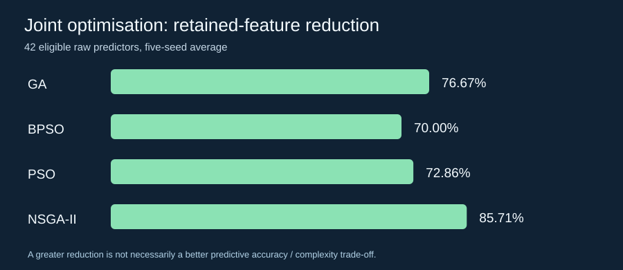

# EvoNIDS — Lecturer's online experiments

**View the graphics directly on GitHub (works even without GitHub Pages):**

**Optional public Pages website (requires the repo owner to enable Pages once):** https://francescoguerriero.github.io/COMP1818_EvoNIDS_with_React/

For full details, use the [all-results index](../results/README.md), [reproduction guide](REPRODUCTION.md) and [Git/submission checklist](GIT_AND_SUBMISSION.md). Historical early GA-leading results are separate from the corrected joint PSO-leading experiment.

All experiment evidence is public on GitHub without installing the project or having access to the student's locally saved model. If GitHub Pages needs enabling, the primary CSV links below remain accessible.

- [Corrected joint: all 20 algorithm/seed results](../results/protocol_runs/20261116T151402Z_full_joint/optimisers/runs.csv)
- [Feature-only: all 20 algorithm/seed results](../results/protocol_runs/20261115T183225Z_full/optimisers/runs.csv)
- [Statistical comparison](../results/statistical_analysis/paired_joint_comparison.csv)
- [Experiment configuration](../results/protocol_runs/20261116T151402Z_full_joint/optimisers/run_config.json)
- [Full-feature baselines](../results/protocol_runs/20261116T151402Z_full_joint/baselines/baseline_summary.csv)
- [Provenance manifest and dataset SHA-256 hashes](../results/protocol_runs/20261116T151402Z_full_joint/manifest.json)
- [Latest five-page LaTeX report PDF](../report/latex/COMP1818_EvoNIDS_LaTeX/main.pdf) and [editable source](../report/latex/COMP1818_EvoNIDS_LaTeX/main.tex)
- [Source dataset](https://research.unsw.edu.au/projects/unsw-nb15-dataset)

## Rerun verification online

[**GitHub Actions: clean Windows verification**](https://github.com/FrancescoGuerriero/COMP1818_EvoNIDS_with_React/actions/workflows/evonids-windows-reproducibility.yml) → **Run workflow**. The hosted runner performs tests, synthetic joint-mode smoke checks, recomputation of statistics from original published CSVs and the React build.

**Limits:** The 40 recorded research runs were produced on the official UNSW-NB15 partitions and are evidenced by their manifest. The GitHub CI does **not** repeat the expensive 300-candidate × 5-seed × 4-method full optimisation. The original GA seed-42 model binary is not hosted, and the evidence dashboard must not be confused with a live network-intrusion detection service. The invalid joint-labelled run of 20261116T100750Z is excluded; only 20261116T151402Z_full_joint supports joint RF hyperparameter claims.
