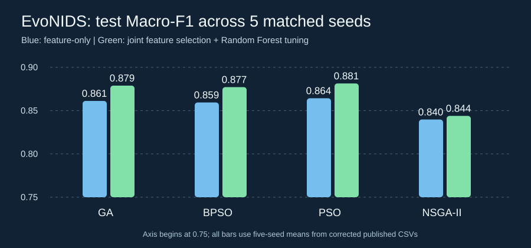
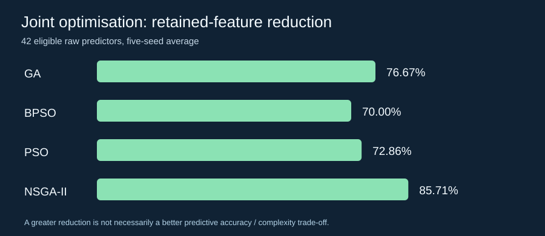

# COMP-1818 EvoNIDS — Public coursework evidence

[**View the online experiment dashboard**](https://francescoguerriero.github.io/COMP1818_EvoNIDS_with_React/) · [**Lecturer's experiment and reproducibility guide**](COMP1818_EvoNIDS_Submission/docs/ONLINE_EXPERIMENTS.md) · [Final coursework report](COMP1818_EvoNIDS_Submission/report/COMP1818_EvoNIDS_Report.pdf)

The corrected experimental results, raw per-seed CSVs, statistical tests, configurations and source code are accessible online. The website shows **published research evidence** rather than synthetic model outputs or live network predictions.

For local development instructions see [project README](COMP1818_EvoNIDS_Submission/README.md).

## Published experimental graphs (visible directly on GitHub)

The figures use five-seed means from the corrected official UNSW-NB15 runs. They are **recorded experiment results**, not live inference. PSO joint mean Macro-F1 is 0.881373; its exact paired Wilcoxon p-value is 0.0625. See the [run-level source data and research limitations](COMP1818_EvoNIDS_Submission/docs/ONLINE_EXPERIMENTS.md).
